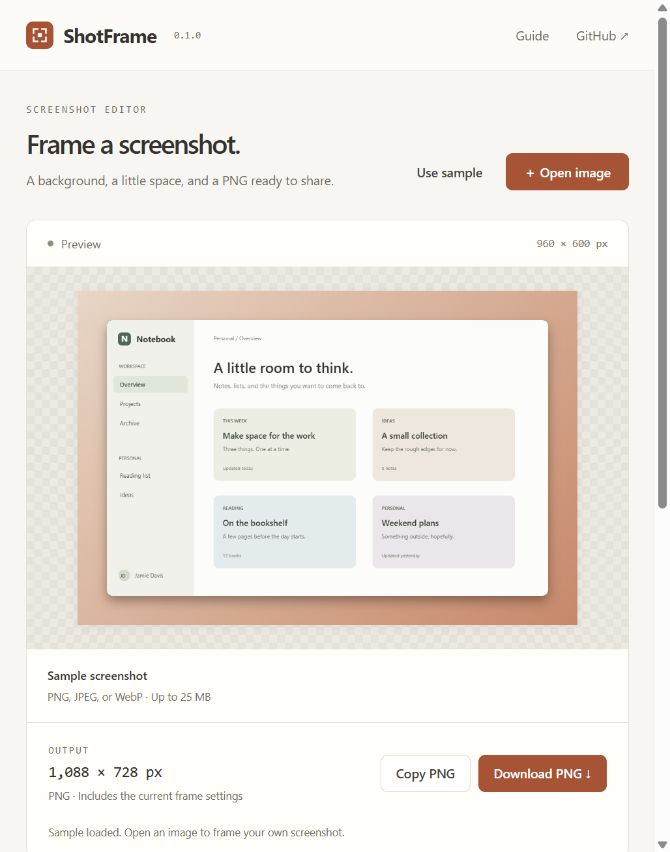

# ShotFrame

[](https://github.com/Almeida96/shotframe/actions/workflows/ci.yml)

Add a background, padding, rounded corners, and an optional window frame to a screenshot. Export the result as a PNG.

[Open the editor](https://almeida96.github.io/shotframe/)



## Hide details before sharing

Enable **Drag on the screenshot to hide an area**, then cover names, tokens, addresses, or other details with a solid black rectangle. The coordinate fields provide the same operation by keyboard, in original source pixels. You can undo or redo the last 30 area changes, clear all areas, and add up to 100 rectangles.

Areas stay attached to the screenshot when padding, shape, window chrome or export scale changes. Loading another image clears them. Resetting frame settings keeps them. Both **Copy PNG** and **Download PNG** paint the masks into the output pixels; the exported file has no editable redaction layer. Inspect the downloaded image and cover the full content, including text edges, before sharing it.

The source file is unchanged. Hidden areas and history live only in the current browser session. There is no text recognition or automatic sensitive-data detection.

## Use

1. Open a PNG, JPEG, or WebP file. You can also drop an image onto the page or paste one with Ctrl+V / Cmd+V.
2. Choose a background and adjust the padding, corners, and shadow.
3. Pick a canvas shape and, if needed, add a light or dark window bar.
4. Download the PNG or copy it to the clipboard.

The sample screenshot is drawn in the browser. **Use sample** changes the image while keeping the frame settings; **Reset** restores the settings while keeping your image.

## Controls

| Setting | Options |
| --- | --- |
| Background | Six presets, custom solid color, two-color gradient, or transparent |
| Direction | Gradient angle from 0° to 360° |
| Canvas shape | Fit screenshot, square 1:1, landscape 16:9, portrait 4:5 |
| Padding | 0–160 pixels on each side, before export scaling |
| Corner radius | 0–48 pixels, limited by the screenshot's dimensions |
| Shadow | 0–64 pixels of blur; 0 removes the shadow |
| Window frame | None, light, or dark, with an optional title |
| Export scale | 0.5×, 1×, or 2× |

Fixed canvas shapes add space around the screenshot without stretching it. The window bar adds 38 pixels above the image. Rounded corners mask the image's corners; set the radius to 0 to retain them. Shadows may be clipped when padding is small.

The preview fits the available screen space. Its rendering resolution is capped at 1,500 pixels per side; the exported PNG uses the dimensions shown under **Output**. Export scaling changes pixel dimensions and does not recover detail missing from the source.

## Files and privacy

Images are decoded and drawn locally with browser APIs. The editor does not upload images, call external APIs, use analytics, or store images and settings between visits. Reloading the page resets the session. Loading the website itself still makes normal requests to its host.

- Input: PNG, JPEG, or WebP, up to 25 MiB, 40 megapixels, and 16,384 pixels per side.
- Output: PNG, up to 8,192 pixels per side and 32 megapixels. Reduce export scale or canvas size if the limit is exceeded.
- Transparent input remains transparent where there is no background or window bar behind it.
- Animated PNG or WebP is flattened to a single frame. GIF and SVG are not accepted.
- Output is rendered from decoded pixels. Source metadata is not copied, and browser color conversion may affect appearance.

Use a current browser with Canvas 2D and `createImageBitmap` support. PNG clipboard copying requires HTTPS or localhost and browser permission; downloading works when copying is unavailable. Mobile browsers may have lower memory limits than the editor's maximum output size.

## Run locally

Requires Node.js 22 or later. There are no dependencies to install.

```sh
git clone https://github.com/Almeida96/shotframe.git
cd shotframe
node scripts/build.mjs
node scripts/serve.mjs
```

Open `http://127.0.0.1:4176`. Rebuild and reload the page after editing source files. ES modules require an HTTP server; opening `index.html` directly from disk is not supported.

## Development

```sh
node scripts/check.mjs
node --test test/*.test.js
node scripts/build.mjs
```

- `src/core.js`: layout, option validation, gradient geometry, file signatures, and output limits.
- `src/render.js`: shared Canvas 2D rendering for preview and export.
- `src/app.js`: file loading, controls, clipboard, and download handling.
- `src/redactions.js`: source-coordinate masks, outward rounding and opaque export rectangles.
- `src/sample.js`: the built-in sample screenshot.

The tests cover layout dimensions, ratios, scaling, bounds, file signatures, and filenames. See [the browser checklist](docs/testing.md) for import and export checks. GitHub Actions runs the checks on Linux, Windows, and macOS, then deploys the static build to GitHub Pages.

## Self-host

Build the project and serve `dist/` from any static HTTP host. All asset paths are relative, so the editor can live under a subdirectory.

The [release ZIP](https://github.com/Almeida96/shotframe/releases/latest) contains the static build. Extract it into your hosting directory. It needs no backend, environment variables, API keys, or database.

## License

[Contributing](CONTRIBUTING.md) · [Changelog](CHANGELOG.md) · [MIT](LICENSE).
